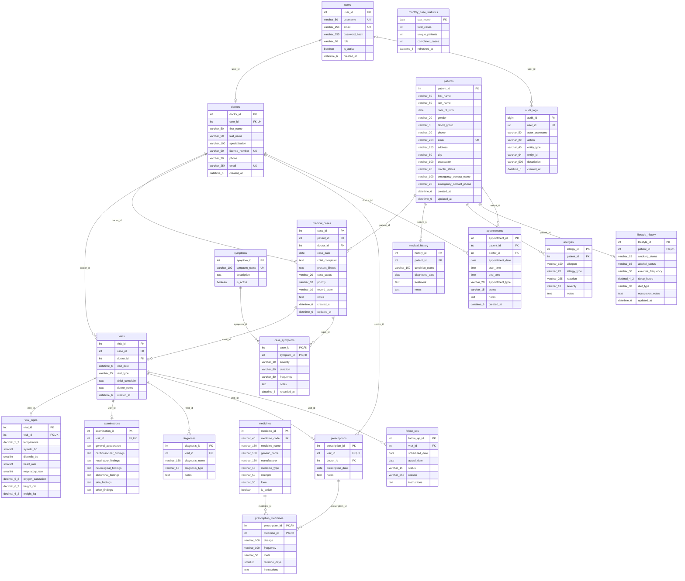

# CareTrack — complete entity–relationship diagram

> Fictional data only. Phase 1 proposed design.

`||` exactly one; `o|` zero or one; `o{` zero or many. PK = primary key; FK = foreign key; UK = unique constraint (Mermaid key annotation). Optional parents have partial participation; non-null child FKs imply total participation on that child side. Composite PK attributes appear on both junction-table columns.

Mermaid uses `UK`, so the source below uses that spelling for UNIQUE. See the relationship matrix for the additional role/submission constraints that cannot be expressed by crow's-foot lines. The standalone monthly cache is deliberately unconnected.

## Other formats

- Open `diagrams/caretrack.drawio` directly in diagrams.net/draw.io.
- Import `diagrams/caretrack.dbml` into dbdiagram.io; Markdown remains authoritative for CHECK constraints and procedural rules.
- MySQL Workbench: after Phase 2 is approved, use Database → Reverse Engineer on the implemented schema, or File → Import → Reverse Engineer MySQL Create Script. Workbench does not directly import Mermaid or DBML; no `.mwb` or executable DDL is claimed at this stage.

The draw.io drawing uses text cardinality labels (`parent 1 / child 0..N`, etc.); Mermaid and the matrix give the formal participation constraints.
